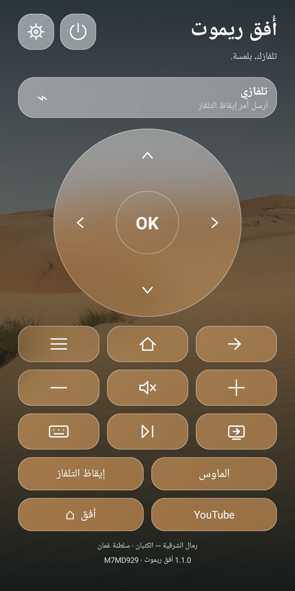
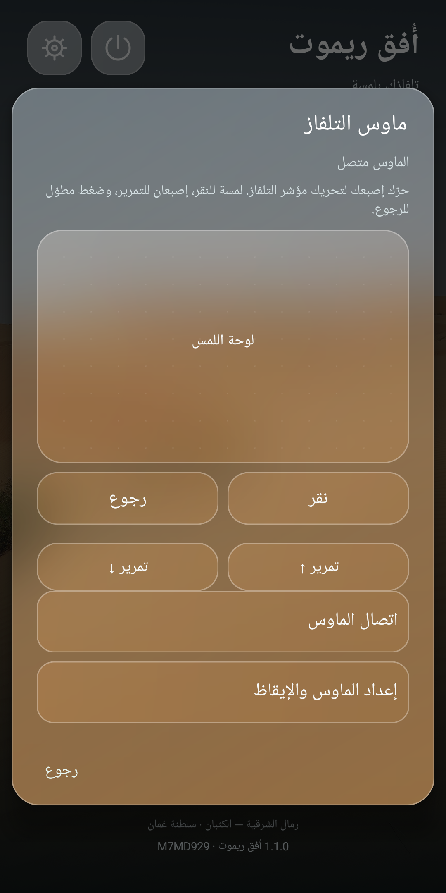

# أُفق ريموت 1.1.0

تطبيق أندرويد عربي للتحكم في Android TV وGoogle TV عبر شبكة المنزل. يستخدم صور عُمان الثلاثين والقرد الموجودين في مشروع أُفق، مع أزرار زجاجية وتصميم عمودي للهاتف. اسم المطور **M7MD929**، والحزمة `om.ufuq.remote` مستقلة عن حزمة التلفاز.

**[تحميل التطبيق APK لأندرويد](https://github.com/M7md929/Ufuq-TV/releases/download/remote-v1.1.0/Ufuq-Remote-1.1.0.apk)** · [صفحة الإصدار](https://github.com/M7md929/Ufuq-TV/releases/tag/remote-v1.1.0) · [واجهة التلفاز](../README.md)

 

## الاستخدام

1. ثبّت `Ufuq-Remote-1.1.0.apk` على هاتف أندرويد 8 فأحدث، وافتح «أُفق ريموت».
2. صِل الهاتف والتلفاز بشبكة الواي فاي نفسها. يجب أن تكون خدمة **Android TV Remote Service** متاحة ومحدّثة على التلفاز.
3. اضغط **اختر التلفاز**، ثم اختر الجهاز المكتشف. إذا لم يظهر، اختر **إدخال عنوان التلفاز يدويًا** وضع عنوانه من إعدادات الشبكة. منفذ الريموت المعتاد **6466**؛ هذا اتصال Remote v2 وليس ADB ولا يستخدم المنفذ 5555.
4. يظهر رمز من ست خانات على التلفاز، وقد يتضمن حروف A–F. أدخله في الهاتف ثم اضغط **ربط التلفاز**. تُفعّل الأزرار بعد اكتمال اتصال الخدمة، ويُحفظ الاقتران للاتصال لاحقًا.
5. إذا تغيّرت شهادة التلفاز أو حُذفت بيانات خدمة الريموت، استخدم **الإعدادات ← إعادة الاقتران بالتلفاز** وأكد الرمز الجديد.

الريموت والكيبورد لا يحتاجان حسابًا أو كمبيوتر أو تصحيح ADB. الماوس الحقيقي إضافة اختيارية تحتاج تفويض ADB كما هو موضح أدناه. لا يغيّر الواجهة الافتراضية للتلفاز. زر «أُفق» يرسل Home؛ لفتح أُفق به يجب تعيين أُفق كواجهة رئيسية على التلفاز، وفق [دليل زر الهوم](https://github.com/M7md929/Ufuq-TV/blob/main/docs/HOME-SETUP.md).

## الأزرار

- الأسهم وOK، مع تكرار الأسهم عند الاستمرار بالضغط.
- الرجوع، Home، القائمة، والمداخل.
- رفع الصوت وخفضه وكتمه، والتشغيل أو الإيقاف المؤقت، وزر الطاقة.
- اختصار YouTube عبر رابط التطبيق.
- الكيبورد: إرسال نص عربي أو إنجليزي، مع حذف وEnter ومسافة وTab والأسهم. افتح حقل كتابة أو بحث على التلفاز لإرسال النص؛ دعم الكتابة يختلف حسب التطبيق المفتوح.
- الماوس: لوحة لمس تحرك مؤشرًا فعليًا على التلفاز، لمسة للنقر، إصبعان للتمرير وأزرار تمرير، وضغط مطول للرجوع.
- إيقاظ التلفاز: زر متاح حتى عند انقطاع الريموت، مع إعادة الاتصال وإرسال WAKEUP دون تبديل الطاقة.

استجابة زر المداخل والقائمة وروابط التطبيقات تعتمد على التلفاز والتطبيق المفتوح.

## إعداد الماوس الحقيقي

1. اتصل بالتلفاز من الريموت أولًا لتحديد عنوانه. افتح **الإعدادات ← الماوس وتشغيل التلفاز**.
2. على التلفاز فعّل خيارات المطور وتصحيح USB / ADB عبر الشبكة. فعّل **اتصال الماوس لهذا التلفاز** في الهاتف وحدد منفذ ADB عبر TCP؛ شاومي Android TV 10 غالبًا يستخدم **5555**. هذا منفذ مختلف عن منفذ الريموت 6466.
3. افتح **الماوس** واضغط **اتصال الماوس**. وافق على رسالة **السماح بتصحيح USB** التي تظهر على التلفاز للهاتف الجديد. تفويض الكمبيوتر السابق لا يفوض الهاتف.
4. عند ظهور «الماوس متصل»، حرّك إصبعك على لوحة اللمس. التحكم والنقر والتمرير يرسلان أحداث ماوس حقيقية، وليست محاكاة أسهم. تختلف استجابة التطبيقات للمؤشر.

اتصال الماوس يدعم ADB التقليدي عبر TCP. **اقتران ADB اللاسلكي الحديث برمز/TLS غير مدعوم بهذا الإصدار**؛ لا تُدخل منفذ الاقتران الحديث في حقل 5555. لا يحتاج الماوس إلى روت أو إضافة إمكانية وصول أو تطبيق مثبت على التلفاز. يُرسل ملف dex صغير إلى `/data/local/tmp/ufuq-pointer-1.1.0.dex` ويشغله التلفاز عبر جلسة ADB المفوضة. لا يفتح منفذ استقبال جديدًا على التلفاز، يرسم مؤشرًا مرئيًا بطبقة SurfaceControl خاصة بجلسة shell، دون إذن تطبيق للعرض فوق التطبيقات. يحتاج ذلك إلى دعم واجهات النظام في التلفاز (اختُبر محاكي Android TV 10)؛ يمكن أن تختلف النماذج الأحدث. وينتهي المؤشر عند قطع الجلسة أو مغادرة تطبيق الهاتف. وإذا انقطعت الشبكة دون إغلاق سليم، يزيل التلفاز المؤشر خلال نحو 15 ثانية بعد توقف نبضات الاتصال. يظل ملف dex المؤقت إلى أن يستبدل أو يحذف عبر ADB. المفتاح الخاص منفصل ومحمي داخل Android Keystore ولا يُصدَّر.

## تشغيل التلفاز من الاستعداد

زر **إيقاظ التلفاز** يرسل `KEYCODE_WAKEUP` (224)، ولا يستخدم زر POWER المتبدل الذي قد يطفئ تلفازًا يعمل بالفعل. زر الطاقة العلوي يفتح اختيار **تشغيل / إيقاظ** أو **وضع الاستعداد** (`KEYCODE_SLEEP` 223).

- إذا بقيت خدمة الريموت متاحة أثناء الاستعداد، يعيد التطبيق الاتصال ويرسل الإيقاظ.
- عند توقف الخدمة، يستخدم **Wake-on-LAN** إذا حفظت عنوان MAC من **الماوس وتشغيل التلفاز**. يمكن أن يُملأ MAC تلقائيًا من اتصال الماوس؛ تأكد أنه يخص اتصال الشبكة المستخدم في التلفاز.
- فعّل **Network standby / تشغيل عبر الشبكة / Wake-on-LAN** في إعدادات التلفاز إن كان موجودًا. دعم الإيقاظ عبر الواي فاي يختلف؛ بعض الأجهزة تدعمه عبر كابل الشبكة فقط.
- إرسال حزمة Wake-on-LAN ليس تأكيدًا بأن الشاشة اشتغلت. يعيد التطبيق محاولة الاتصال لمدة تقارب 40 ثانية ثم يبين عدم الاستجابة. تتوقف المحاولات عند مغادرة التطبيق.
- **لا يمكن تشغيل جهاز مفصول من الكهرباء، ولا جهاز قطع الشبكة في السكون ولا يدعم الإيقاظ منها**. التطبيق ليس ريموت أشعة تحت الحمراء.

## الخلفيات والقرد

من **الإعدادات ← الخلفيات والصور** تستطيع اختيار صورة أو التبديل العشوائي كل دقيقتين. الصور الأصلية ومعايناتها محفوظة داخل التطبيق، وتُقصّ بما يناسب شاشة الهاتف دون تشويه. هي مجموعة التلفاز نفسها؛ اختيار الصورة والتبديل مستقلان بين الهاتف والتلفاز في هذا الإصدار، ولا توجد مزامنة تلقائية للصورة الحالية.

القرد يظهر **داخل تطبيق الريموت فقط** ولا يعترض اللمس ولا يظهر فوق تطبيقات الهاتف الأخرى. افتراضيًا توجد فرصة واحدة كل ساعة أثناء بقاء التطبيق مفتوحًا، باحتمال 2%. يمكن تعديل النسبة أو إيقافه أو اختيار **جرّب القرد الآن** من إعداداته. تتوقف الحركة والاتصال والبحث عند مغادرة التطبيق، ويُعاد الاتصال بالجهاز المحفوظ عند العودة. لا تُعوّض الفرص الماضية ولا يظهر القرد مباشرة عند التشغيل.

## الاتصال والخصوصية

التحكم محلي عبر Android TV Remote v2 مع TLS وشهادة عميل في Android Keystore. لا يُصدَّر المفتاح الخاص. يتحقق رمز الاقتران من مفاتيح الطرفين؛ لا تُحفظ شهادة التلفاز إلا بعد نجاح إثبات الرمز. بعد الاقتران يُرفض الاتصال إذا لم تطابق بصمة شهادة التلفاز البصمة المحفوظة. لا يُسجّل رمز الاقتران.

البحث يستخدم mDNS للخدمة `_androidtvremote2._tcp.`، مع إدخال يدوي بديل. الأذونات: الإنترنت، وحالة الشبكة والواي فاي، وMulticast للبحث المحلي. اتصال الماوس اختياري عبر ADB TCP مفوض من التلفاز، وWake-on-LAN يرسل حزمة بث محلي فقط. لا توجد إعلانات أو تحليلات أو حسابات، ولا أذونات كاميرا أو ميكروفون أو جهات اتصال أو عرض فوق التطبيقات أو إمكانية وصول.

## التحقق

- اجتاز فحص Java عدد 80 تحققًا: بروتوكول الريموت وUTF-8 ورمز الاقتران وحركة القرد، مع ADB framing والتحقق من RSA-2048 وصيغة Wake-on-LAN وعناوين MAC وأبعاد الشاشة.
- في 1.1.0 اختُبر الكيبورد الجديد وWAKEUP عبر طرف Remote v2 مستقل. واختُبر توقيع Android Keystore بواسطة طرف ADB مستقل، ونقل dex وتشغيل المؤشر كـ shell على محاكي Android TV 10 ثانٍ، ووصول HOVER والنقر والتمرير وظهور مؤشر SurfaceControl. اختبار ADB استخدم طرف بروتوكول مستقل يمرر مرحلة shell إلى المحاكي؛ لا يُعد هذا اختبارًا جديدًا لـ ADB على شاومي الحقيقي.
- لم يكن شاومي متاحًا على عنوانه السابق أثناء تطوير 1.1.0. تشغيله من السكون وWake-on-LAN يحتاجان اختبارًا على الجهاز نفسه؛ لا تدّعي هذه النسخة نجاح إيقاظ كل تلفاز.
- اختُبر تطبيق APK على محاكي Android 10 بأبعاد هاتف: رفض رمز خاطئ، واقتران TLS، و13 زر تحكم، وكتابة نص بالعدادات المتفاوض عليها، ورابط YouTube، وKeepalive، وبقاء الاقتران بعد إعادة تشغيل العملية، ومعرض الصور ومعاينة القرد بالفيديو.
- استُخدم طرف اختبار مستقل يفك الرسائل بمخططات protobuf من المشروع المرجعي، ثم غُيّرت شهادة الخادم وتحقّقنا من رفضها.
- في 1.0.0 اختُبر التطبيق من المحاكي مع تلفاز Xiaomi MiTV-MOOQ1 الحقيقي: اكتمل الاقتران والتحكم، وأرسل زر Home ففتح أُفق على التلفاز. أُعيد يوتيوب بعد الاختبار.
- لم يُثبّت على هاتف المستخدم الفعلي بعد. البحث التلقائي وظروف الشبكات المختلفة تحتاج التحقق على الهاتف؛ الإدخال اليدوي اختُبر مع شاومي.

## البناء

JDK 17 أو أحدث، Android SDK Build Tools 36.1.0 ومنصة android-36.1. لا حاجة إلى Gradle أو مكتبات تشغيل خارجية.

```powershell
.\build.ps1 -JdkPath 'C:\path\to\jdk-17' -SdkPath 'C:\path\to\Android\Sdk'
.\tests\run-checks.ps1 -JdkPath 'C:\path\to\jdk-17'
```

الناتج في `build/Ufuq-Remote.apk`. احتفظ بمفتاح التطبيق الموجود محليًا في `signing/` لتوقيع تحديثات تقبل التثبيت فوقه. لا يتضمن أرشيف المصدر هذا المفتاح؛ بناء المصدر على جهاز آخر ينشئ مفتاح تطوير مختلفًا.

## المصادر

راجع [NOTICE](NOTICE.md) و[رخصة البروتوكول المرجعي](LICENSE-androidtvremote2.txt) و[مصادر صور عُمان](assets/credits.txt). تبقى الصور خاضعة لرخصها الفردية وحقوق أصحابها؛ بعض صور الهجر ليست تحت رخصة حرة. صورة القرد مولدة بواسطة ImageGen. لا تُمنح رخصة إضافية لإعادة نشر الصور بمجرد وجودها في المشروع.
